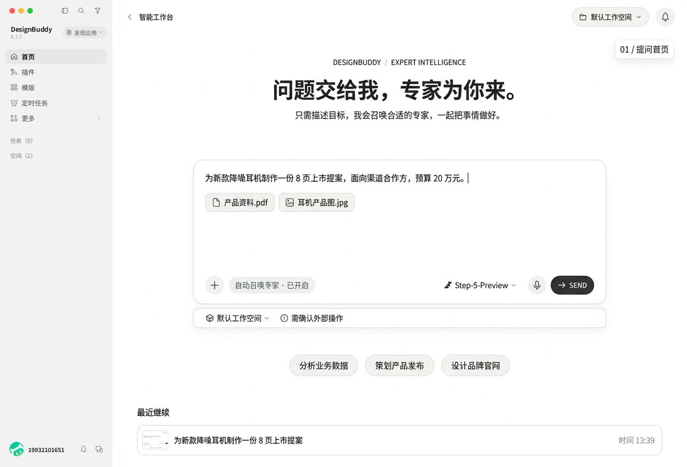
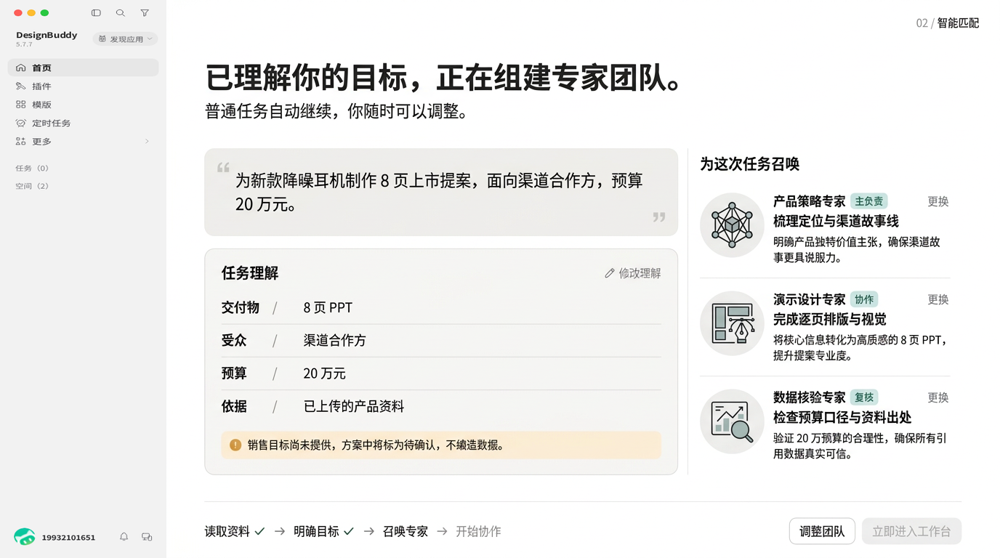
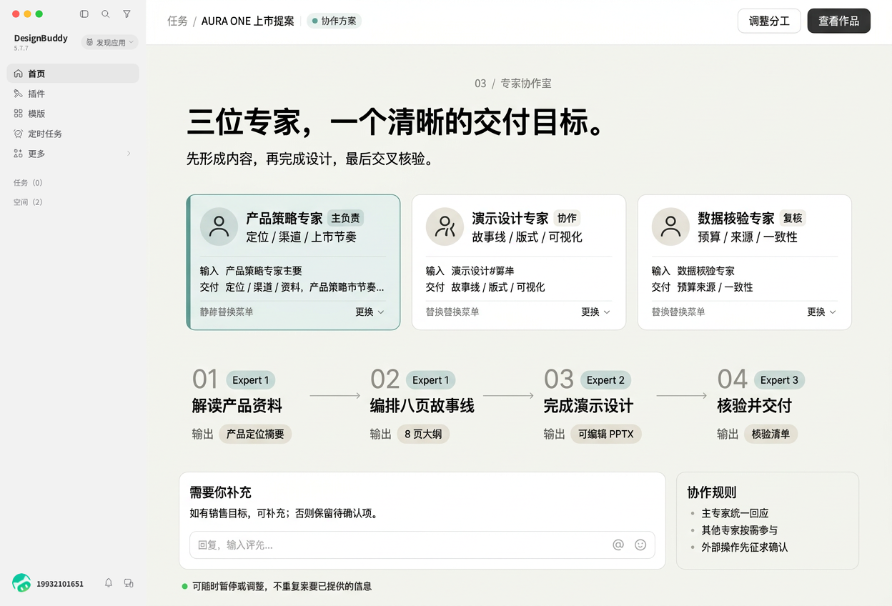
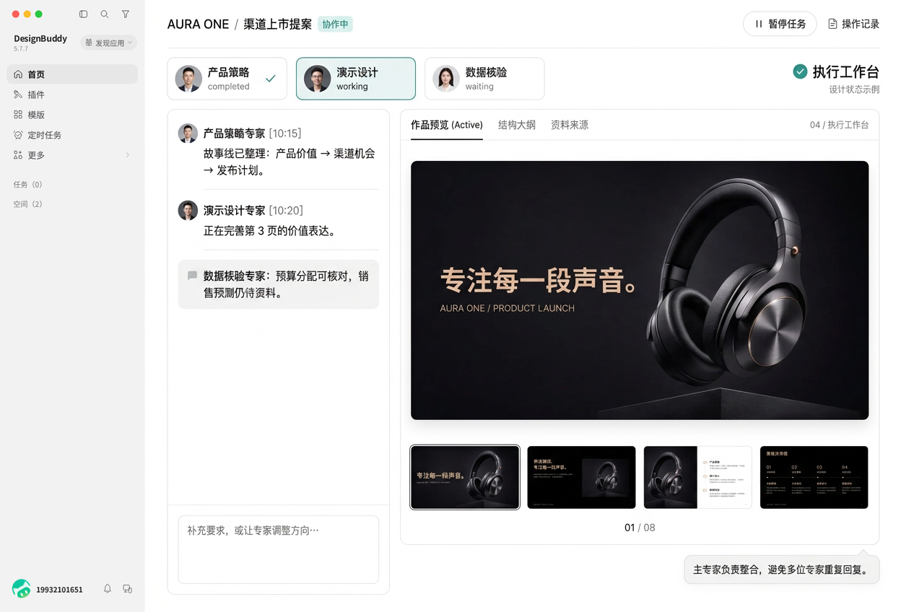
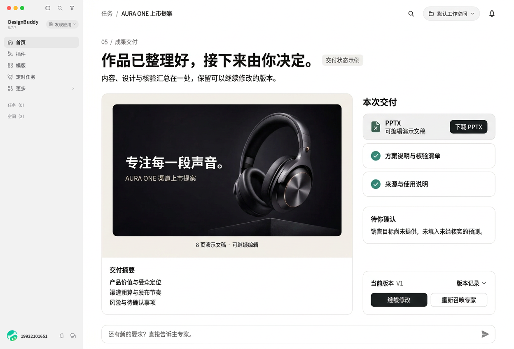

# DesignBuddy · 根据问题智能召唤专家

## 设计提案与 5 张关键界面图

**状态：设计提案，尚未改动应用页面或接入新的专家调度服务。**

本次提供的是同一套产品方案的 **5 张独立关键界面设计图**，覆盖提问、匹配、分工、执行和交付，不是同一张首页换五种颜色。以“为新款降噪耳机制作 8 页渠道上市提案”为贯穿案例，方便判断流程是否连贯。

推荐方向：**让用户提出问题，而不是先学会挑专家。**

> 提出目标 → 理解问题 → 按需召唤专家 → 协作完成 → 交付可修改的成果

这里的“专家”是 AI 专业角色与对应能力组合，不意味着真人专家、官方认证或保证结论正确。图中的角色、状态、时间、附件和结果均为设计示例。

---

## 一、改版的核心决定

### 1. 从专家目录变成问题入口

现有专家目录适合“我已经知道要找谁”，不适合“我只知道遇到了什么问题”。目录继续保留，但降为“手动选择 / 管理我的专家”的次级入口。

新主入口只强调三个动作：描述问题、添加资料、开始处理。输入区旁清楚显示“自动召唤专家 · 已开启”，不要求用户先选择行业、角色或专家团。

### 2. 不是每个问题都召唤一队人

- 简单问题：一位主专家直接处理，例如润色邮件、解释一个报错。
- 跨领域任务：一位主专家加必要的协作角色，例如数据分析加演示设计。
- 有核验要求的任务：增加复核角色，例如数据口径、来源或测试验证。
- 默认优先少而精，建议 1–3 个角色；不为营造热闹固定召唤三位专家。

### 3. 能解释为什么匹配，但不打断流程

用具体职责解释匹配：例如“需要把产品资料整理为渠道故事线，所以召唤产品策略专家”。不展示没有依据的“匹配度 99%”“权威认证”或虚构专家热度。

普通任务自动继续。第二张的匹配摘要、第三张的协作方案，在实际产品中可以是可展开状态，不强制用户连续点击五个页面。

### 4. 只有必要时才请求确认

- 关键目标缺失且无法合理处理：提出一个明确问题，同时保留原输入和附件。
- 次要信息不足：标为“待确认”或明确说明假设，不编造事实。
- 涉及发送、支付、发布、删除、对外调用或新的付费消耗：按照权限和费用策略确认后再执行。
- 工具未连接：显示缺少什么能力及可行替代方案，不能先显示“已执行”。

### 5. 保留用户掌控权

用户可以查看依据、更换专家、删去多余协作角色、暂停执行、补充要求或重新分工。修改问题后说明哪些步骤受影响，尽量只重做受影响部分。

模型、附件、工作空间、权限和已写内容不因召唤专家而丢失。日常办公、代码开发、设计创意三种模式可以继续保留为偏好入口，不再成为必须先选择的步骤；不擅自切换用户已有的模式或任务配置。

---

## 二、视觉方向

- **左侧导航保持现状**：五张图均使用现有侧栏作为固定框架。
- **右侧重新组织**：问题、分工、作品是视觉重点，不再把专家商品卡片铺满首屏。
- **颜色**：灰白基础、深灰正文、低饱和青绿用于主负责和关键状态；待确认事项使用浅暖色。
- **排版**：正文建议 14px，主标题约 30–36px，辅助信息 12px；正式实现使用真实字体，避免依赖图片里的小字。
- **角色识别**：推荐统一使用简洁的专业能力图标或字母标识。图中头像为角色占位，不表示真人服务。
- **动效**：输入后展开理解摘要，角色按实际状态出现，完成步骤收拢；不做假打字、假进度条或机器人漂浮动画。
- **手机端**：以当前任务为主；过程与作品通过页签切换，不把桌面双栏硬塞进窄屏。

---

## 图 1｜提问首页

**目标：用户不用知道该找谁，直接说出要解决的问题。**

### 页面重点

- 主标题：**问题交给我，专家为你来。**
- 大输入区、资料附件、自动召唤开关。
- 模型 → 语音 → 发送，延续现有操作顺序。
- 工作空间与权限保留在输入区附近。
- 下方只保留少量问题示例和最近任务，不再用大量入口分散注意力。

### 关键交互

用户点击发送后才正式开始。输入过程中如有推荐，仅作提示，不自动执行任务或调用付费服务。“手动选择专家”放在自动召唤设置内，不抢主入口。

---

## 图 2｜智能匹配

**目标：让用户知道系统理解了什么，以及为什么由这些专家处理。**

### 页面重点

- 左侧展示问题原文与结构化理解：目标、成果、受众、预算、资料来源。
- 右侧展示主专家和必要协作者，每个角色都有具体职责和匹配理由。
- 不足信息清楚标注，例如“销售目标尚未提供，不编造预测”。
- “修改理解”“更换专家”可直接操作。

### 关键交互

通常自动进入执行，不要求额外确认。只有关键歧义才暂停并提问。匹配依据来自问题、附件、用户偏好和实际可用能力，而非固定关键词把所有问题分给同一组专家。

---

## 图 3｜专家协作室

**目标：展示可执行的分工，而不是摆出几个头像。**

### 页面重点

- 一位主专家统一负责，协作角色有明确输入和交付物。
- 顺序清楚：解读资料 → 编排故事线 → 完成设计 → 核验交付。
- 每一步对应具体结果：定位摘要、大纲、PPTX、核验清单。
- 需要用户补充的内容独立呈现，避免淹没在群聊中。

### 关键交互

能调整分工、移除非必要角色或补充材料。调整后说明对计划的影响。专家之间共享必要的任务上下文，不反复向用户索要已提交的资料。

---

## 图 4｜执行工作台

**目标：既看得到过程，又始终看得到正在做的作品。**

### 页面重点

- 左侧约三分之一：必要的进展摘要、待确认事项和补充输入。
- 右侧约三分之二：实际作品，支持预览、结构大纲、资料来源切换。
- 顶部角色状态明确区分：待开始、处理中、等待资料、待确认、完成、失败或暂停。
- 用户能暂停、调整方向、查看操作记录。

### 关键交互

不输出冗长的内部思考过程，不让每位专家重复回复。展示用户可以验证的操作、结果和依据。状态只能来自实际运行事件；异常保留已有成果，并提供重试或更换处理方式。

作品区沿用已经建设的场景编辑能力：PPT 逐页编辑、表格单元格操作、海报画布、文档内容等，不退回为只能阅读的一张截图。

---

## 图 5｜成果交付

**目标：优先交付作品，不用长篇“任务完成总结”代替成果。**

### 页面重点

- 左侧大面积展示成果及简明交付摘要。
- 右侧提供对应格式文件、核验清单、资料与使用说明。
- “待确认”事项不因流程结束而消失。
- 保留版本记录、继续修改和重新召唤入口。

### 关键交互

下载实际生成的文件；文件不存在时不显示可下载成功状态。继续修改默认保留上下文和主专家，必要时再补充其他角色。修改前后的版本可以比较，用户不必重新描述整项任务。

---

## 三、智能召唤如何落地

### 调度步骤

1. **解析需求**：提取目标、交付格式、资料、约束和需要澄清的问题。
2. **检查可用能力**：哪些专家、模型、技能和工具真的可用；权限是否允许。
3. **形成精简分工**：选择主专家，必要时增加协作与复核角色；说明选择理由。
4. **执行与汇总**：专家围绕同一个任务和成果工作，主专家统一对用户回应。
5. **校验和交付**：检查格式、内容完整性、来源和未解决问题，生成真实交付文件。

### 问题与角色示例

| 用户问题 | 默认安排 | 是否需要多人 |
| --- | --- | --- |
| 帮我润色一封工作邮件 | 商务写作角色 | 通常不需要 |
| 找出销量下降原因并做汇报 | 数据分析主负责，演示设计协作；涉及口径时加入复核 | 按需 |
| 排查接口报错并补测试 | 工程诊断主负责，测试角色协作 | 按问题范围 |
| 做一套新品上市方案 | 产品策略主负责，演示设计协作；数据不足时补核验 | 按资料与交付要求 |
| 做品牌海报和活动排期 | 视觉设计与营销策划分工 | 有两个独立交付物时需要 |

这些角色安排是产品规则示例，不是当前已经运行的智能调度结果。真正的专家匹配需要连接模型、角色配置、任务状态和工具权限；不能仅用几条文案演出“自动召唤”。

---

## 四、建议的实施顺序与验收

### 第一阶段：主体验

提问入口、自动匹配摘要、可调整的专家分工、上下文保留。保留旧专家目录作为次级入口。

### 第二阶段：协作和场景编辑

将任务计划、实际执行状态、失败恢复和现有 15 个场景工作区连接起来，形成“过程 + 作品”的执行界面。

### 第三阶段：交付与追问

统一文件、版本、来源、待确认项和继续修改。接入外部服务时单独处理权限、费用和真实执行反馈。

### 验收重点

- 只输入一个问题也能开始，不强制手工挑专家。
- 简单任务不机械地召唤多人；复杂任务分工可解释。
- 更换专家不丢问题、资料、已完成内容和权限设置。
- 未接入服务不能显示真实执行成功。
- 暂停、失败、重试和需要补充资料都有明确界面。
- 交付文件与实际成果一致，用户能够继续编辑。
- 手机、键盘导航、焦点提示及减少动态效果得到支持。

---

## 文件说明

- `01-ask.png`：提问首页
- `02-match.png`：智能匹配
- `03-team.png`：专家协作室
- `04-workbench.png`：执行工作台
- `05-delivery.png`：成果交付

设计图为 AI 生成的视觉提案，已统一复用现有侧栏；主要用于确认布局、层级和交互方向。正式页面以本说明中的文案、真实字体与可操作控件为准。本轮未修改应用功能代码。
