# DesignBuddy 首页设计探索

这些文件是 AI 生成的静态视觉概念图，用于选择布局方向；不是已实现的产品界面。图中的账户、项目、模型及任务文案均为示意，不代表功能或接入状态。当前首页代码没有按这些概念图替换。

## 第一轮：5个不同方向

[查看5页设计合集](initial-directions/DesignBuddy-home-5-designs.pdf)

| 编号 | 方向 | 原图 |
| --- | --- | --- |
| 01 | 极简对话 | [PNG](initial-directions/01-minimal.png) |
| 02 | 项目工作台 | [PNG](initial-directions/02-project-workbench.png) |
| 03 | 编辑部风格 | [PNG](initial-directions/03-editorial.png) |
| 04 | 深色专业版 | [PNG](initial-directions/04-dark-professional.png) |
| 05 | 灵感画布 | [PNG](initial-directions/05-inspiration-canvas.png) |

## 第二轮：15张极简对话首页

[查看完整15页设计合集](minimal-conversation/DesignBuddy-minimal-01-15.pdf)

围绕输入框的位置与形态、留白、工具展开方式以及最近对话呈现进行独立探索。均保留左侧导航，不加入机器人或积分任务横幅。

| 编号 | 方向 | 设计说明 | 原图 |
| --- | --- | --- | --- |
| 01 | 纯净居中 | 只保留输入与少量提示，让空白成为主体 | [PNG](minimal-conversation/01-quiet-center.png) |
| 02 | 顶部输入 | 任务输入靠上，打开就能开始 | [PNG](minimal-conversation/02-top-aligned.png) |
| 03 | 底部对话框 | 输入框固定在底部，接近真实聊天界面 | [PNG](minimal-conversation/03-bottom-composer.png) |
| 04 | 窄栏专注 | 收窄输入区，建议按纵向排列 | [PNG](minimal-conversation/04-narrow-column.png) |
| 05 | 左右错位 | 问候在左、输入在右，改变视觉重心 | [PNG](minimal-conversation/05-offset-dialogue.png) |
| 06 | 单行命令框 | 把大输入面板缩成一条轻量命令栏 | [PNG](minimal-conversation/06-command-bar.png) |
| 07 | 无边框画布 | 弱化容器边界，像在空白纸上书写 | [PNG](minimal-conversation/07-borderless-canvas.png) |
| 08 | 侧边轻历史 | 对话优先，历史仅用右侧文字呈现 | [PNG](minimal-conversation/08-discreet-history.png) |
| 09 | 输入框内引导 | 把起步提示整合进输入区，不额外堆卡片 | [PNG](minimal-conversation/09-prompt-with-starters.png) |
| 10 | 对话笔记本 | 输入与最近对话串成一条清晰的纵向路径 | [PNG](minimal-conversation/10-conversation-notebook.png) |
| 11 | 模式切换 | 极简中央输入框上方放置对话/写作/设计小型分段切换，其他内容清空 | [PNG](minimal-conversation/11-mode-selector.png) |
| 12 | 窄侧栏留白 | 88px竖栏保留导航图标和短中文标签，扩大中央对话画布 | [PNG](minimal-conversation/12-slim-navigation.png) |
| 13 | 渐进展开 | 聚焦后的输入框展开附件/上下文/技能工具架，显示小型附件菜单，不堆项目卡片 | [PNG](minimal-conversation/13-progressive-composer.png) |
| 14 | 安静夜间 | 深炭色极简对话，仅输入框和文字提示，不做深色仪表盘 | [PNG](minimal-conversation/14-night-conversation.png) |
| 15 | 写信式对话 | 暖白纸面、左对齐中号宋体问句、弱边界输入与开始对话文字按钮 | [PNG](minimal-conversation/15-letter-like.png) |

## 预览

以下为15张极简方向方案，编号与PDF页码一致。

### 01 · 纯净居中

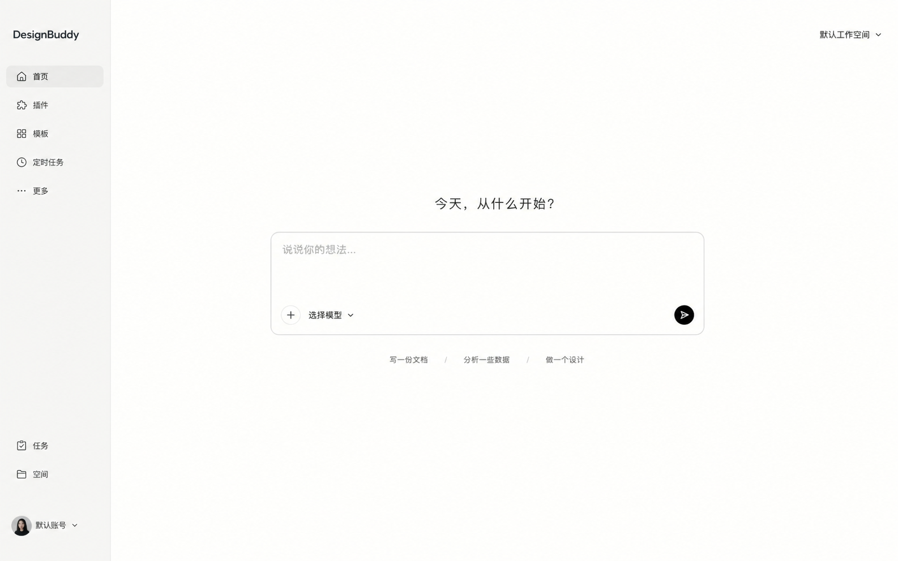

### 02 · 顶部输入

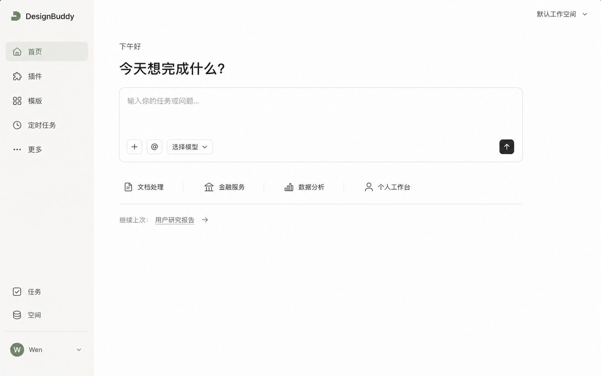

### 03 · 底部对话框

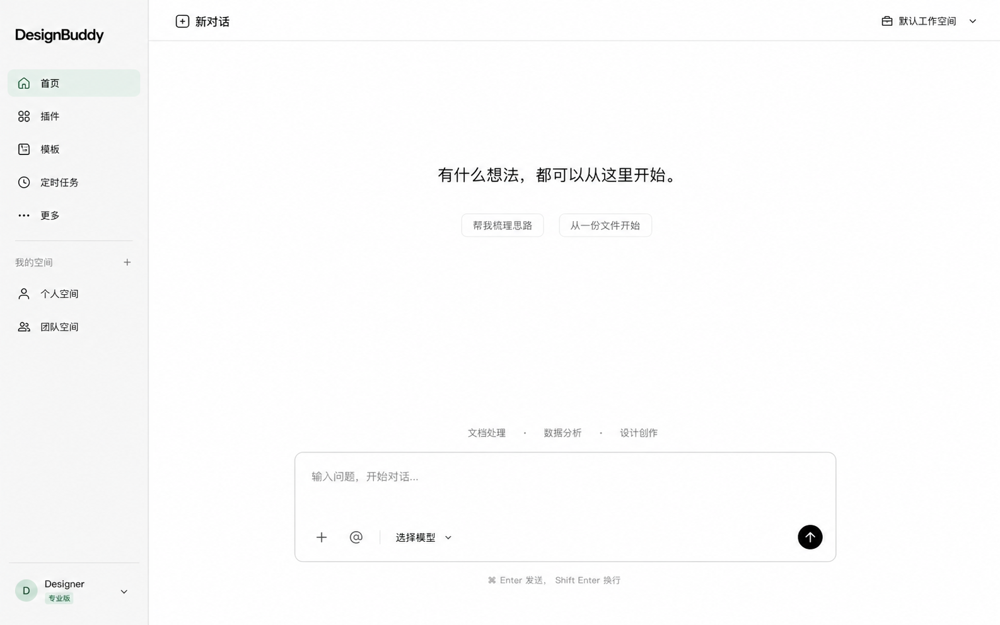

### 04 · 窄栏专注

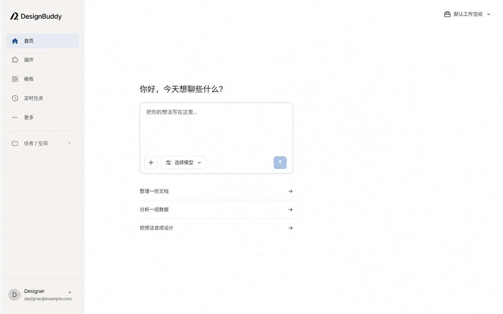

### 05 · 左右错位

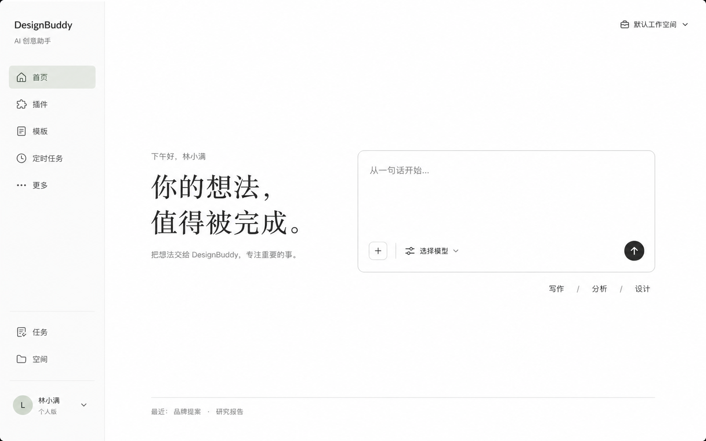

### 06 · 单行命令框

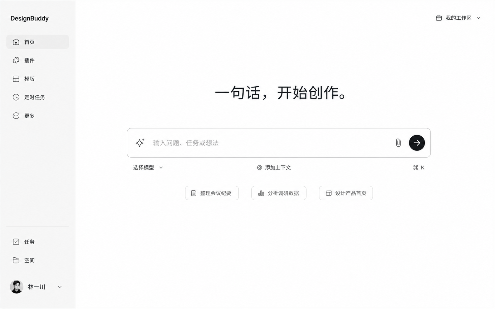

### 07 · 无边框画布

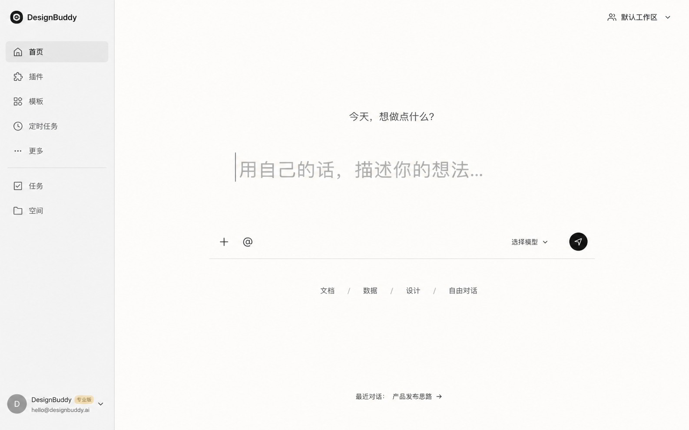

### 08 · 侧边轻历史

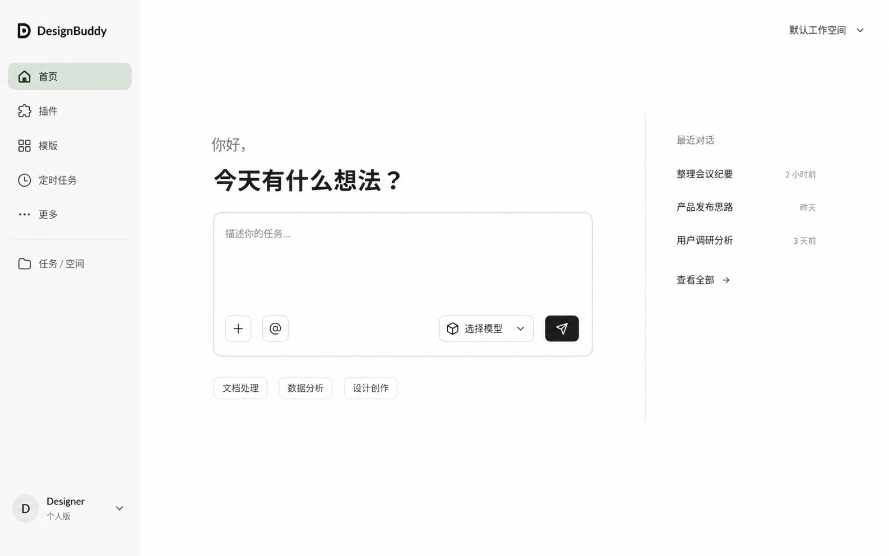

### 09 · 输入框内引导

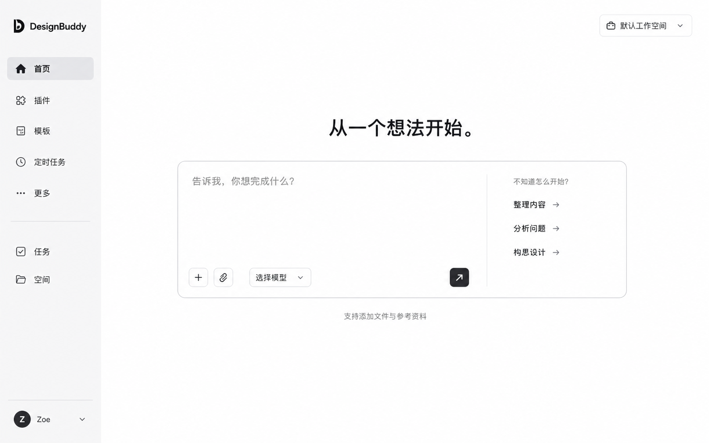

### 10 · 对话笔记本

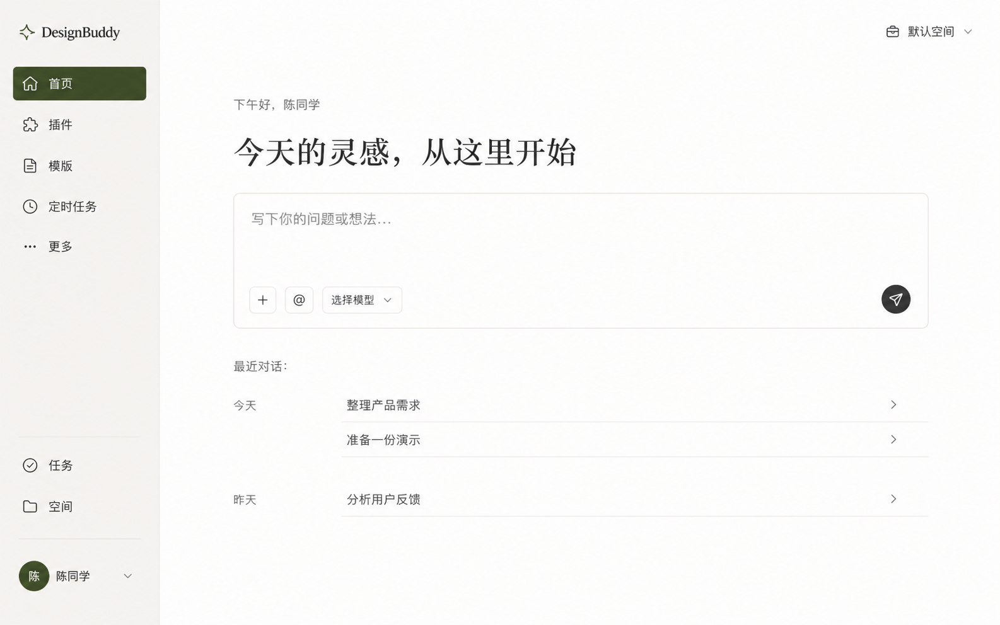

### 11 · 模式切换

### 12 · 窄侧栏留白

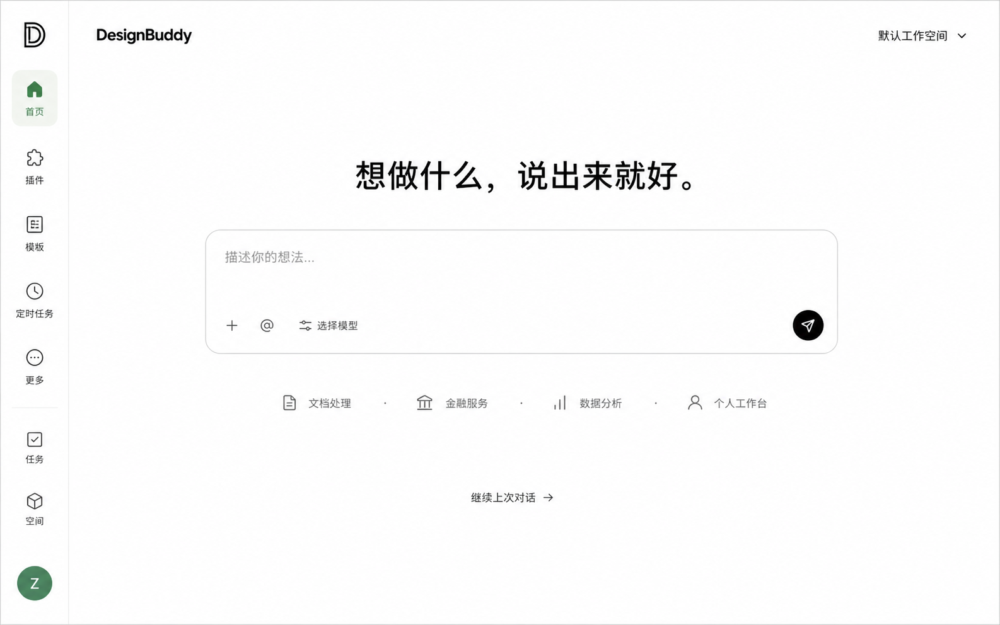

### 13 · 渐进展开

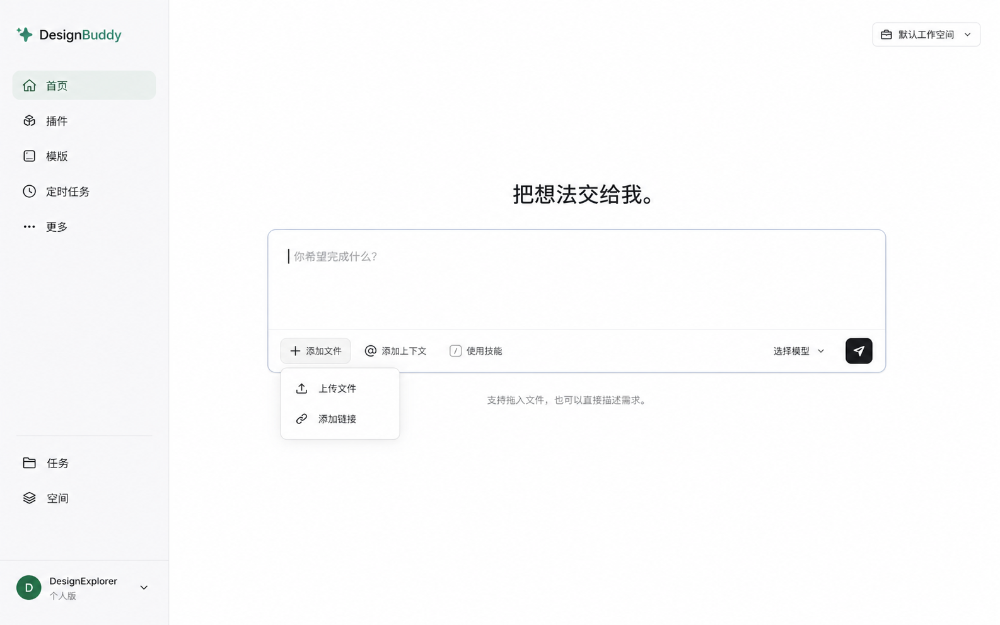

### 14 · 安静夜间

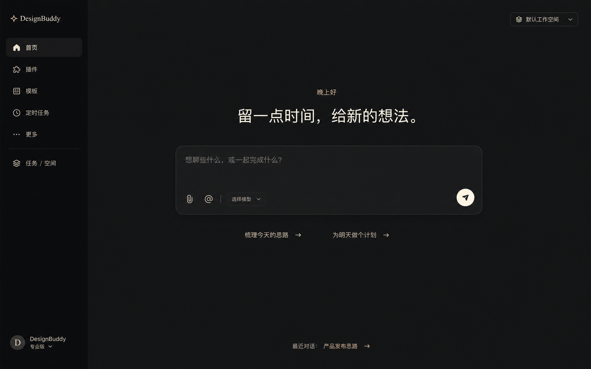

### 15 · 写信式对话

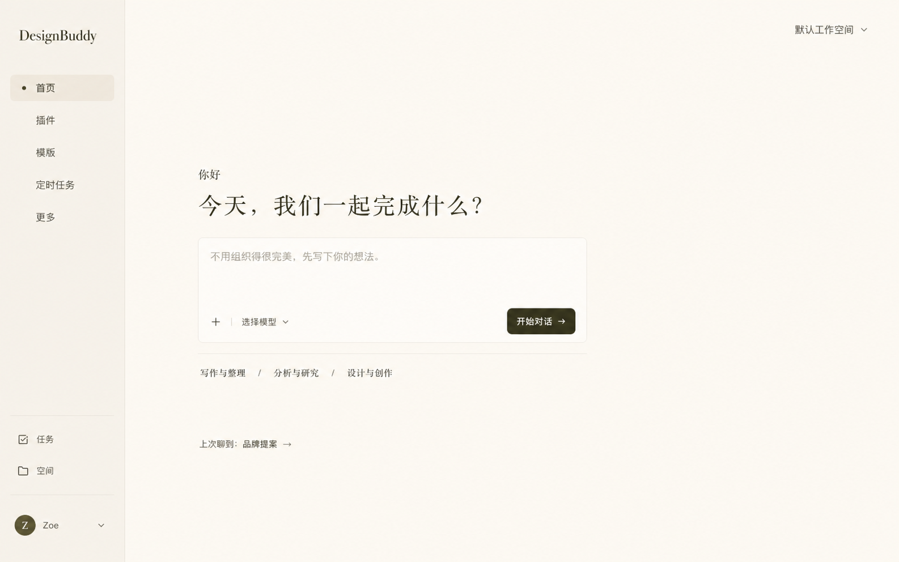
